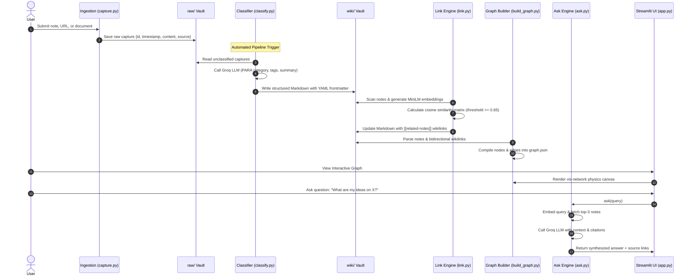
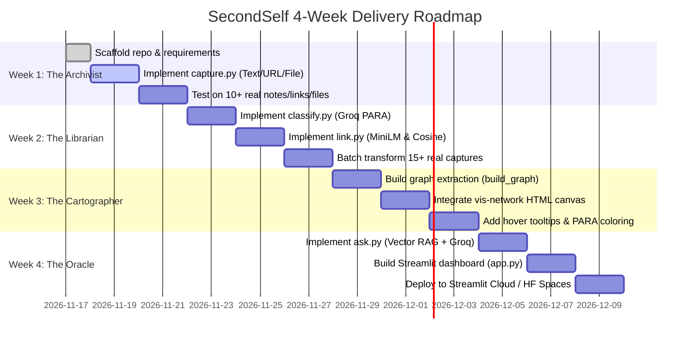

# SecondSelf: System Architecture Specification
**Document Version:** 1.0.0  
**Target Platform:** Python 3.10+, Streamlit, Groq API / Llama 3, Sentence-Transformers, Vis-network  
**Author:** AI System Architect  

---

## 1. System Vision & Overview

**SecondSelf** is an autonomous, self-organizing personal knowledge engine. Rather than functioning as a passive note storage bucket or a generic disconnected chatbot, SecondSelf implements a continuous knowledge pipeline:
1. **Ingest** raw multi-modal information (notes, URLs, files) with zero friction.
2. **Classify** and structure knowledge automatically using the PARA methodology (*Projects, Areas, Resources, Archives*) via LLM reasoning.
3. **Connect** notes automatically via dense semantic vector embeddings and bidirectional links.
4. **Visualize** the holistic knowledge topography as a dynamic, interactive force-directed graph.
5. **Synthesize** answers to natural-language queries grounded strictly in personal accumulated notes (Retrieval-Augmented Generation).
6. **Deploy** as a single lightweight, publicly accessible web application.

---

## 2. High-Level Architecture

```mermaid
flowchart TD
    subgraph Ingestion["1. Ingestion Layer (Week 1: The Archivist)"]
        UI_In["Web Capture UI (app.py)"]
        CLI_In["CLI Capture (capture.py)"]
        URL_Scraper["URL Fetcher (trafilatura / readability)"]
        File_Parser["File Extractor (pypdf, markdown, txt)"]
        Raw_Store[("Raw Vault: raw/{id}.json")]
        
        CLI_In --> Raw_Store
        UI_In --> Raw_Store
        URL_Scraper -.-> CLI_In
        File_Parser -.-> CLI_In
    end

    subgraph Processing["2. Semantic Organization (Week 2: The Librarian)"]
        Classifier["Classifier Engine (classify.py)"]
        LLM["Fast LLM (Groq / Llama 3)"]
        Embedder["Embedding Engine (link.py - all-MiniLM-L6-v2)"]
        Linker["Auto-Linker (Cosine Similarity Engine)"]
        Wiki_Store[("Wiki Vault: wiki/{category}/{slug}.md")]
        
        Raw_Store --> Classifier
        Classifier <--> LLM
        Classifier --> Wiki_Store
        Wiki_Store --> Embedder
        Embedder --> Linker
        Linker -->|Inject [[wikilinks]]| Wiki_Store
    end

    subgraph KnowledgeGraph["3. Graph Engine (Week 3: The Cartographer)"]
        Graph_Builder["Graph Builder (build_graph.py)"]
        Graph_JSON[("Graph Cache: graph.json")]
        Vis_Engine["Interactive Graph Component (vis-network.js)"]
        
        Wiki_Store --> Graph_Builder
        Graph_Builder --> Graph_JSON
        Graph_JSON --> Vis_Engine
    end

    subgraph QueryRAG["4. Synthesis Engine (Week 4: The Oracle)"]
        Query_Input["User Query (Natural Language)"]
        Dense_Retrieval["Semantic Search (top-k cosine sim)"]
        Prompt_Builder["Grounded Context Assembler"]
        Answer_Gen["Synthesis LLM (Groq / Llama 3)"]
        
        Query_Input --> Dense_Retrieval
        Embedder -.-> Dense_Retrieval
        Dense_Retrieval -->|Top-k relevant notes| Prompt_Builder
        Wiki_Store -.-> Prompt_Builder
        Prompt_Builder --> Answer_Gen
    end

    subgraph Presentation["5. Unified Interface (Streamlit)"]
        App["Streamlit Dashboard (app.py)"]
        Vis_Engine --> App
        Answer_Gen --> App
    end
```

---

## 3. Data Flow & Lifecycle



---

## 4. Component Deep-Dive

### 4.1. Module 1: The Archivist (Capture Pipeline)
- **Role:** High-speed capture without cognitive friction.
- **Inputs:**
  - Raw strings / quick thoughts
  - Web URLs (scraped clean of ads/boilerplate using `trafilatura` or `beautifulsoup4`)
  - Files (`.txt`, `.md`, `.pdf` via `pypdf`)
- **Storage Contract:**
  Files stored in `raw/{id}.json`:
  ```json
  {
    "id": "20261116-162000-a1b2c3",
    "timestamp": "2026-11-16T16:20:00Z",
    "source_type": "url",
    "source_ref": "https://example.com/article",
    "title": "Article Title or First Line",
    "raw_content": "...full text...",
    "processed": false
  }
  ```

### 4.2. Module 2: The Librarian (Classification & Auto-Linking)
- **Role:** Turns unstructured captures into a clean, connected Markdown personal wiki.
- **Classification Engine (`classify.py`):**
  - Uses Groq API (`llama-3.3-70b-versatile` or `llama-3.1-8b-instant`) with strict JSON mode.
  - Categorizes into Tiago Forte's **PARA Framework**:
    - **Projects:** Active goals with finite deadlines.
    - **Areas:** Ongoing spheres of activity/responsibility.
    - **Resources:** Reference materials, topics of interest, bookmarks.
    - **Archives:** Inactive items saved for posterity.
  - Outputs structured YAML frontmatter + markdown body saved to `wiki/{category}/{slug}.md`.
- **Note Schema (`wiki/.../*.md`):**
  ```markdown
  ---
  id: "20261116-162000-a1b2c3"
  title: "Building Micro-SaaS with Python"
  para_category: "Projects"
  tags: ["saas", "python", "ideas"]
  summary: "Actionable roadmap for shipping small web services using FastAPI."
  created_at: "2026-11-16T16:20:00Z"
  source: "https://example.com/article"
  links:
    - "[[python-best-practices]]"
    - "[[indie-hacking-handbook]]"
  ---

  # Building Micro-SaaS with Python
  
  [Summary / curated content here]

  ## Related Notes
  - [[python-best-practices]] (similarity: 0.78)
  - [[indie-hacking-handbook]] (similarity: 0.71)
  ```
- **Semantic Auto-Linker (`link.py`):**
  - Embedding Model: `sentence-transformers/all-MiniLM-L6-v2` (runs 100% locally, 0 API cost, ~80MB memory footprint, 384 dimensions).
  - Maintains `wiki/.embeddings.npz` (or lightweight FAISS index / pickle).
  - On new note: calculates cosine similarity with all existing notes.
  - Threshold `cosine_sim >= 0.65` auto-appends bidirectional wikilinks (`[[note-slug]]`) to frontmatter and "Related Notes" section.

### 4.3. Module 3: The Cartographer (Knowledge Graph & Visualizer)
- **Role:** Extracts network topology and produces an interactive visual brain.
- **Graph Builder (`build_graph.py`):**
  - Parses frontmatter and `[[wikilinks]]` regex patterns `r"\[\[(.*?)\]\]"` across all `wiki/**/*.md`.
  - Builds graph data structure:
    - **Nodes:** `id`, `label` (title), `group` (PARA category), `summary`, `tags`, `val` (node size scaled by in/out degree).
    - **Edges:** `from`, `to`, `weight` (similarity score), `color`.
  - Exports to `graph.json`.
- **Visualization Component (`components/graph.html`):**
  - Powered by **vis-network** (HTML5 Canvas + ForceAtlas2 physics simulation).
  - Features:
    - Node color mapped to PARA (e.g., Red: Projects, Blue: Areas, Green: Resources, Gray: Archives).
    - Hover card showing note summary, category, and tags.
    - Click node to preview full note in a slide-out panel or markdown viewer.
    - Search / filter nodes by category or tags.
    - Responsive zoom, drag, and node physics stabilization.

### 4.4. Module 4: The Oracle (RAG Engine & Streamlit App)
- **Role:** Natural language Q&A synthesizing personal notes with source attribution.
- **Query Pipeline (`ask.py`):**
  1. User asks: *"What framework should I use for my next side project?"*
  2. Embed query using `all-MiniLM-L6-v2`.
  3. Compute similarity against all note embeddings; retrieve top-3 to top-5 most relevant notes.
  4. Build prompt:
     ```text
     You are SecondSelf, the user's personal AI second brain.
     Answer the question using ONLY the provided notes from their personal wiki.
     Always cite your sources using [[Note Title]].
     If the answer is not in the notes, explicitly state that you don't have that information in your brain.
     
     --- Context Notes ---
     [Note 1: title, summary, content]
     [Note 2: title, summary, content]
     ---------------------
     Question: {query}
     Answer:
     ```
  5. Call Groq LLM to generate answer with streaming support.
- **Unified Interface (`app.py`):**
  - Single-page application built on Streamlit with custom CSS.
  - Layout:
    - **Sidebar:** Ingestion bar (quick text box, URL input, file uploader) + Brain Stats (note count, connection count, PARA breakdown).
    - **Main Area (2 Tabs):**
      - **Tab 1: Living Brain Graph** (Full-screen interactive vis.js canvas).
      - **Tab 2: Ask Your Brain** (Chat interface with expandable source context cards).

---

## 5. Technology Stack & Design Decisions

| Layer | Technology | Selection Rationale |
|---|---|---|
| **Language** | Python 3.10+ | Native ecosystem for NLP, RAG, embeddings, and Streamlit. |
| **Web Framework** | Streamlit | Rapid development, built-in session state, zero-cost 1-click deployment on Streamlit Community Cloud. |
| **Primary LLM** | Groq API (`llama-3.3-70b` / `llama-3.1-8b`) | Ultra-fast token generation (~300 tokens/sec), generous free tier, structured JSON output. |
| **Embeddings** | `sentence-transformers/all-MiniLM-L6-v2` | Runs locally, zero API dependency/rate limits, highly accurate for short-to-medium text. |
| **Vector Storage** | NumPy / In-Memory Cosine Matrix | Zero external database overhead for 100-5,000 personal notes; keeps repo portable and self-contained. |
| **Graph UI** | `vis-network` (JS) embedded via `streamlit.components.v1.html` | Rich force-directed physics, smooth canvas rendering, hover/click event callbacks, superior to static networkx. |
| **Content Scraping**| `trafilatura` / `requests` / `pypdf` | Robust text extraction for links and PDF uploads. |
| **Deployment** | Streamlit Community Cloud / Hugging Face Spaces | Native git-push continuous deployment, free HTTPS hosting. |

---

## 6. Directory Structure Blueprint

```text
Second Brain/
├── .streamlit/
│   └── config.toml          # Custom theme & headless runner configuration
├── data/
│   ├── raw/                 # Week 1: Raw captured items ({id}.json)
│   └── wiki/                # Week 2: Organized PARA markdown notes
│       ├── Projects/
│       ├── Areas/
│       ├── Resources/
│       └── Archives/
├── src/
│   ├── __init__.py
│   ├── capture.py           # Ingestion CLI & core handler
│   ├── classify.py          # PARA classification & LLM summarization
│   ├── link.py              # Local embedding generator & semantic linker
│   ├── build_graph.py       # Graph nodes/edges compiler
│   ├── ask.py               # RAG retrieval & answer synthesizer
│   └── utils.py             # File parsers (PDF, URL scraper, markdown parser)
├── static/
│   ├── graph_template.html  # Vis-network interactive HTML/JS template
│   └── styles.css           # Custom styling for Streamlit
├── app.py                   # Week 4: Streamlit UI uniting Graph + Search + Capture
├── requirements.txt         # Pinned lightweight dependencies
├── .env.example             # GROQ_API_KEY template
├── README.md                # Documentation & quickstart guide
└── docs/
    ├── ARCHITECTURE.md      # This document
    └── Problem statement.txt
```

---

## 7. Execution Strategy & Weekly Milestones



---

## 8. Failure Modes & Edge Case Safeguards

1. **Cold Start / Empty Graph:**
   - Pre-populate fallback sample notes or graceful empty-state placeholders in UI if `wiki/` contains < 2 notes.
2. **Groq API Rate Limits / Network Outage:**
   - Fallback to rule-based keyword classification and local TF-IDF / heuristic categorization if API is unreachable.
3. **Link Explosion (Dense Hairball Graph):**
   - Restrict max automated edges per note to top-3 highest similarity scores above threshold ($0.65 \le \text{similarity} \le 0.98$) to prevent over-clustering.
4. **Hallucination in RAG Answers:**
   - Strict system prompt grounding: if retrieved context similarity is below $0.40$, answer: *"I could not find relevant notes in your Second Brain to answer this question."*
5. **Streamlit Deployment Performance:**
   - Cache heavy embedding models with `@st.cache_resource` so `all-MiniLM-L6-v2` loads only once in memory during the app lifecycle.
   - Cache graph compilation with `@st.cache_data`.
