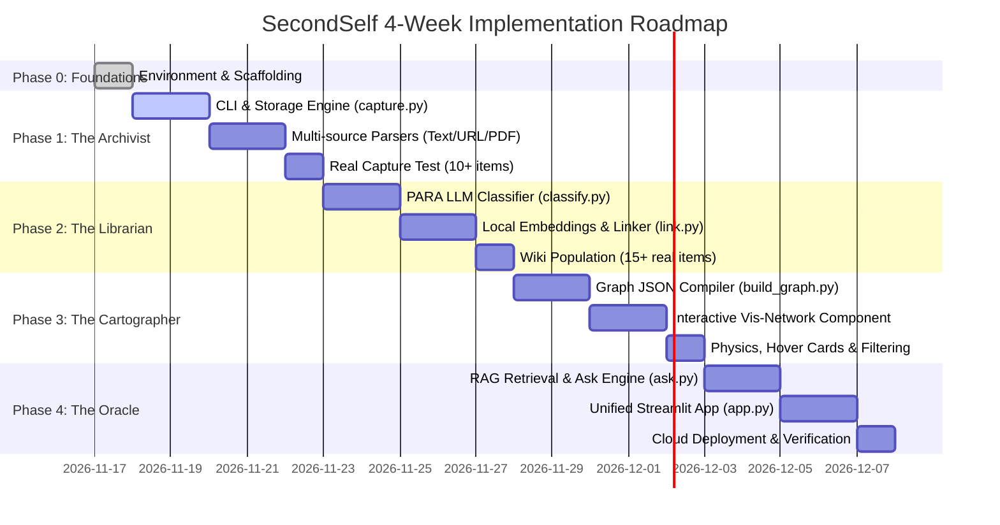

# SecondSelf: Phase-Wise Implementation Plan
**Reference Documents:** [Problem statement.txt](file:///c:/Users/jagad/OneDrive/Desktop/Second%20Brain/docs/Problem%20statement.txt) | [ARCHITECTURE.md](file:///c:/Users/jagad/OneDrive/Desktop/Second%20Brain/docs/ARCHITECTURE.md)  
**Target Delivery:** 4-Week Progressive Milestone Execution  
**Badge System:** The Archivist 🏅 $\rightarrow$ The Librarian 🏅 $\rightarrow$ The Cartographer 🏅 $\rightarrow$ The Oracle 🏅  

---

## 1. Roadmap & Milestone Overview



---

## 2. Phase 0: Project Scaffolding & Environment Setup

### Objectives
Establish a reproducible, clean Python environment with all core dependencies and configuration files.

### Tasks
- [ ] **Task 0.1: Directory Tree Creation**
  ```bash
  mkdir -p raw wiki/Projects wiki/Areas wiki/Resources wiki/Archives static src .streamlit
  ```
- [ ] **Task 0.2: Pin Dependencies (`requirements.txt`)**
  - Core: `pydantic>=2.0`, `python-dotenv>=1.0.0`
  - Ingestion: `requests>=2.31.0`, `trafilatura>=1.6.0`, `pypdf>=3.17.0`
  - AI & Embeddings: `groq>=0.11.0`, `sentence-transformers>=2.2.2`, `numpy>=1.24.0`
  - Visualization & App: `streamlit>=1.38.0`, `networkx>=3.1`
- [ ] **Task 0.3: Environment Configuration (`.env.example`)**
  - Define `GROQ_API_KEY=`
  - Define optional custom thresholds: `SIMILARITY_THRESHOLD=0.65`, `MAX_RELATED_LINKS=4`
- [ ] **Task 0.4: Streamlit Theming (`.streamlit/config.toml`)**
  - Configure dark theme: background `#0E1117`, secondary `#262730`, text `#FAFAFA`, primary `#FF4B4B`.

---

## 3. Phase 1 (Week 1): The Archivist — "Capture Everything, Lose Nothing"

### Objective
Build a frictionless, robust one-command ingestion pipeline that handles quick notes, web URLs, and files without data loss.

### Architecture Mapping
- **Component:** `src/capture.py`, `src/utils/scrapers.py`, `src/utils/parsers.py`
- **Output Target:** `raw/{id}.json`

### Detailed Task Breakdown

#### Task 1.1: Core Ingestion Script (`src/capture.py`)
- Implement CLI using `argparse`:
  - `python src/capture.py --text "Note content..." --title "Optional Title"`
  - `python src/capture.py --url "https://example.com/article"`
  - `python src/capture.py --file "/path/to/document.pdf"`
- Generate deterministic timestamped IDs: `YYYYMMDD-HHMMSS-<6-char-uuid>` (e.g. `20261117-142010-f4b2a1`).

#### Task 1.2: Content Extractors
- **URL Scraper (`src/utils/scrapers.py`):** Use `trafilatura` to extract clean readable text, stripping ads, scripts, and boilerplate. Fallback to basic `BeautifulSoup4` with `<meta>` extraction.
- **File Parser (`src/utils/parsers.py`):**
  - Plain text & Markdown: direct UTF-8 read.
  - PDF: `pypdf.PdfReader` to concatenate text across pages cleanly.

#### Task 1.3: Data Validation & Raw Storage
- Validate payload structure using Pydantic:
  ```python
  class RawCapture(BaseModel):
      id: str
      timestamp: str
      source_type: Literal["text", "url", "file"]
      source_ref: str
      title: str
      raw_content: str
      processed: bool = False
  ```
- Save each item as atomic JSON in `raw/{id}.json`.

### Testing & Acceptance Criteria
- [ ] Command line captures raw text successfully into `raw/`.
- [ ] Command line captures web page content via URL and extracts clean article text.
- [ ] Command line extracts text from PDF and TXT files.
- [ ] **Milestone Check:** Capture at least **10+ real pieces** of personal data (articles, project ideas, bookmarks, notes).
- [ ] 🏅 **Badge Achieved:** The Archivist

---

## 4. Phase 2 (Week 2): The Librarian — "Teach AI to Organize For You"

### Objective
Transform unstructured raw captures into a structured, self-organizing Markdown personal wiki categorized via PARA and connected through dense vector similarity.

### Architecture Mapping
- **Components:** `src/classify.py`, `src/link.py`
- **Target Vault:** `wiki/{Projects,Areas,Resources,Archives}/{slug}.md`

### Detailed Task Breakdown

#### Task 2.1: PARA Auto-Classifier (`src/classify.py`)
- Call Groq LLM (`llama-3.3-70b-versatile` or `llama-3.1-8b-instant`) with JSON mode.
- System prompt enforces the PARA taxonomy:
  - **Projects:** Active, goal-oriented tasks with finite completion targets.
  - **Areas:** Long-term standards, domains of life/work (e.g., Health, Finances, Coding).
  - **Resources:** Reference material, topics of interest, book notes, tools.
  - **Archives:** Inactive or completed projects and past references.
- Schema extraction:
  ```json
  {
    "title": "Clean Title",
    "category": "Projects",
    "tags": ["tag1", "tag2"],
    "summary": "One-line distillation of the core idea.",
    "clean_markdown": "Structured content in markdown with headers..."
  }
  ```
- Generate note filename: `slugify(title).md`.
- Save note into `wiki/{category}/{slug}.md` with YAML frontmatter.
- Mark source `raw/{id}.json` as `"processed": true`.

#### Task 2.2: Local Embedding & Semantic Auto-Linker (`src/link.py`)
- Initialize `sentence-transformers/all-MiniLM-L6-v2` (runs 100% locally on CPU/GPU, zero cost).
- Compute embeddings for all notes in `wiki/` combining: `title + summary + tags + content[:500]`.
- Store embeddings cache in `wiki/.embeddings.npz` (avoid recomputing on every run).
- For each note:
  - Compute cosine similarity with every other note.
  - Filter by similarity threshold ($\text{threshold} \ge 0.65$ and $\ne 1.0$).
  - Take the top-3 most similar notes.
  - Auto-insert `[[target-note-slug]]` into the YAML frontmatter and append a `## Related Notes` section to the markdown body.

### Testing & Acceptance Criteria
- [ ] Classifier transforms raw JSON items into structured YAML-frontmatter Markdown notes.
- [ ] Every processed note is filed into one of the 4 PARA directories.
- [ ] Embeddings compute locally without remote API failures or rate limits.
- [ ] Related notes show bidirectional or incoming `[[wikilinks]]`.
- [ ] **Milestone Check:** Run pipeline across **15+ real items** to create a fully organized `wiki/`.
- [ ] 🏅 **Badge Achieved:** The Librarian

---

## 5. Phase 3 (Week 3): The Cartographer — "Visualize the Brain"

### Objective
Parse the wiki notes and bidirectional wikilinks to construct a living, interactive, force-directed graph of the user's mind.

### Architecture Mapping
- **Components:** `src/build_graph.py`, `static/graph_template.html`
- **Output:** `data/graph.json` rendered through `vis-network.js`

### Detailed Task Breakdown

#### Task 3.1: Graph Data Model Compiler (`src/build_graph.py`)
- Traverse all `.md` files in `wiki/`.
- Parse YAML frontmatter (ID, title, PARA category, tags, summary) and find all regex matches `r"\[\[(.*?)\]\]"`.
- Formulate Nodes:
  - `id`: unique note slug.
  - `label`: note title.
  - `group`: PARA category (Projects: `#EF4444`, Areas: `#3B82F6`, Resources: `#10B981`, Archives: `#6B7280`).
  - `summary`: one-sentence synopsis for hover tooltip.
  - `tags`: tag list.
  - `val`: dynamic node scale computed as $10 + 4 \times (\text{degree centrality})$.
- Formulate Edges:
  - `from`: source slug.
  - `to`: target slug.
  - `weight`: cosine similarity score.
- Output clean serialized JSON to `data/graph.json`.

#### Task 3.2: Vis-Network Interactive HTML Canvas (`static/graph_template.html`)
- Build a standalone interactive canvas powered by `vis-network` (v9.1.2 via CDN):
  - **Physics Simulation:** ForceAtlas2 solver with smooth stabilization.
  - **Hover Tooltips:** Rich custom HTML card showing Title, PARA badge, Tags, and Summary.
  - **Click Handler:** Fires callback to open/preview full note markdown.
  - **Controls:** Category toggle filters, physics freeze toggle, search bar to focus and zoom on a node.

### Testing & Acceptance Criteria
- [ ] `build_graph.py` parses all notes and produces valid `graph.json` without broken references.
- [ ] Interactive graph renders in a browser window with force-directed physics.
- [ ] Hovering over nodes reveals the note summary, category, and tags.
- [ ] Drag, zoom, and node filtering work smoothly.
- [ ] **Milestone Check:** Graph visually reveals clusters and connections between real notes.
- [ ] 🏅 **Badge Achieved:** The Cartographer

---

## 6. Phase 4 (Week 4): The Oracle — "Ask It Anything, Ship It Public"

### Objective
Build a natural-language Q&A retrieval engine over the user's notes, unify everything into a polished Streamlit application, and deploy it to a public URL.

### Architecture Mapping
- **Components:** `src/ask.py`, `app.py`
- **Deployment Platform:** Streamlit Community Cloud / Hugging Face Spaces

### Detailed Task Breakdown

#### Task 4.1: Natural Language RAG Engine (`src/ask.py`)
- Implement `ask(query: str) -> dict`:
  1. Embed user query using `all-MiniLM-L6-v2`.
  2. Compute cosine similarity against cached note embeddings.
  3. Retrieve top-$k$ notes ($k=3\text{ to }5$) with similarity score $\ge 0.40$.
  4. If top similarity is below threshold, return polite fallback: *"I don't have notes on that topic in your brain yet."*
  5. Format context block with note titles, summaries, and excerpt contents.
  6. Call Groq LLM (`llama-3.3-70b-versatile`) with strict grounding prompt requiring `[[Title]]` citations.
  7. Return synthesized response + list of cited note metadata.

#### Task 4.2: Streamlit Dashboard Assembly (`app.py`)
- Unify all components into a responsive two-column / tabbed application:
  - **Sidebar:**
    - Live Capture Form (Quick Note text area, URL input, File upload with instant ingestion button).
    - Brain Statistics (Total notes, PARA category breakdown pills, total links).
    - Pipeline Trigger: *"Sync & Re-index Brain"* button.
  - **Tab 1: Living Brain (Visual Graph):**
    - Embedded `vis-network` HTML canvas via `streamlit.components.v1.html`.
    - Category legend and interactive node inspection drawer.
  - **Tab 2: Ask Your Brain (RAG Search):**
    - Conversational chat interface (`st.chat_message`, `st.chat_input`).
    - Grounded answers with streaming tokens.
    - Expandable cards showing the exact source notes used in the answer.

#### Task 4.3: Cloud Deployment
- Prepare repository for public deployment:
  - Verify `.gitignore` excludes sensitive keys, virtual environments, and `.embeddings.npz` (recalculated on build or included if static).
  - Configure Streamlit Cloud Secrets: `GROQ_API_KEY`.
  - Add cold-start caching using `@st.cache_resource` for the embedding model and `@st.cache_data` for the graph JSON.
  - Deploy to Streamlit Community Cloud and obtain public HTTPS URL.

### Testing & Acceptance Criteria
- [ ] `ask()` synthesizes answers exclusively from personal notes and provides valid citations.
- [ ] Streamlit app integrates Capture, Graph visualization, and Q&A into one UI.
- [ ] App launches smoothly on Streamlit Cloud with public URL accessibility.
- [ ] 🏅 **Badge Achieved:** The Oracle

---

## 7. Deliverables & Acceptance Checklist

| Phase | Milestone / Badge | Deliverables | Verification Command |
|---|---|---|---|
| **Phase 0** | Scaffold | `requirements.txt`, directory tree, `.env.example` | `pip install -r requirements.txt` |
| **Phase 1** | **The Archivist** 🏅 | `src/capture.py`, 10+ real items in `raw/` | `python src/capture.py --text "My note"` |
| **Phase 2** | **The Librarian** 🏅 | `src/classify.py`, `src/link.py`, 15+ organized notes in `wiki/` | `python src/classify.py && python src/link.py` |
| **Phase 3** | **The Cartographer** 🏅 | `src/build_graph.py`, `graph.json`, interactive `vis-network` UI | `python src/build_graph.py` |
| **Phase 4** | **The Oracle** 🏅 | `src/ask.py`, `app.py`, live public Streamlit URL | `streamlit run app.py` |

---

## 8. Risk Management & Fallback Strategies

| Potential Failure Mode | Likelihood | Impact | Built-in Mitigation |
|---|---|---|---|
| **Groq API Rate Limits / Outage** | Low | High | Implement exponential backoff retry; cache LLM responses locally by note hash. |
| **Dense Graph Clustering (Hairball effect)** | Medium | Medium | Cap auto-links to top 3 per note; impose upper similarity cap ($0.98$) to avoid duplicate note clutter. |
| **Memory Overruns on Free Cloud Tier** | Low | High | Use lightweight `all-MiniLM-L6-v2` (384-dim, ~80MB RAM) instead of multi-gigabyte models. |
| **Slow Streamlit Cold Starts** | Medium | Low | Use `@st.cache_resource` to keep the embedding model resident in memory across user sessions. |
