# SecondSelf: Streamlit Cloud Deployment Plan

> **Project:** SecondSelf — Your Personal AI Second Brain  
> **Target:** [Streamlit Community Cloud](https://share.streamlit.io)  
> **Repository:** `https://github.com/DarkFur-K9/Second-Brain`  
> **Main App File:** `app.py`  
> **Python Version:** 3.11+ (recommended for Streamlit Cloud compatibility)

---

## ⚠️ Pre-Deployment Checklist

Before deploying, verify all of these are true locally:

- [x] `app.py` is at the **root** of the repository
- [x] `requirements.txt` lists all dependencies (no `torch` extras needed — `sentence-transformers` auto-installs CPU torch)
- [x] `.env` is in `.gitignore` (secrets never committed)
- [x] `.streamlit/config.toml` is committed (dark theme + headless server config)
- [x] `wiki/` notes are committed to Git (the cloud has no local filesystem persistence)
- [x] `graph.json` and `graph.html` are committed (pre-compiled graph output)
- [x] `wiki/.embeddings.npz` is **excluded** from Git (`.gitignore`) — it will be **recomputed on cold start**

> [!IMPORTANT]
> Streamlit Community Cloud uses an **ephemeral filesystem** — any files written at runtime (new captures, re-indexed embeddings) are lost on the next deployment or restart. The wiki notes and graph bundled in Git are the stable read-only baseline.

---

## 🏗️ Phase 1: Repository Preparation

### 1.1 — Pin Python Version

Create a `.python-version` file at the repository root to tell Streamlit Cloud which Python to use:

```bash
echo "3.11" > .python-version
git add .python-version
git commit -m "chore: pin Python version to 3.11 for Streamlit Cloud"
```

> [!TIP]
> Python 3.11 has the best compatibility with `sentence-transformers`, `torch` CPU wheels, and Streamlit on the cloud build system. Avoid 3.14 (too new for cloud build caches).

### 1.2 — Freeze Exact Dependencies

Replace `requirements.txt` range specifiers with exact pinned versions to ensure reproducible cloud builds:

```bash
# Activate your local venv first
.venv\Scripts\activate
pip freeze > requirements.txt
git add requirements.txt
git commit -m "chore: freeze exact dependency versions for cloud deployment"
```

> [!NOTE]
> `pip freeze` captures the exact installed versions from your local `.venv`. This prevents version drift between local and cloud builds.

### 1.3 — Verify `.gitignore` Exclusions

Confirm these patterns are in `.gitignore` and **nothing sensitive is tracked**:

```gitignore
.env               # Groq API key — NEVER commit
.venv/             # Local virtualenv
wiki/.embeddings.npz   # Recomputed on first run
*.npz              # Any other numpy cache
.streamlit/secrets.toml  # Cloud secrets file (local only)
.obsidian/         # Obsidian app settings
```

Run this to verify no secrets are staged:
```bash
git status
git diff --cached   # Should show nothing sensitive
```

### 1.4 — Commit Pre-Built Graph & Wiki

The cloud has no Groq API budget to re-classify notes on first boot. Commit the pre-built assets:

```bash
git add wiki/ graph.json graph.html
git commit -m "chore: include pre-classified wiki notes and compiled graph for cold start"
git push origin main
```

---

## 🔐 Phase 2: Secrets Configuration

Streamlit Community Cloud uses its own **Secrets Manager** instead of `.env` files.

### 2.1 — Identify Required Secrets

| Secret Key | Description | Where Used |
|---|---|---|
| `GROQ_API_KEY` | Groq LLM API key for classification and RAG Q&A | `src/classify.py`, `src/ask.py` |

### 2.2 — Set Secrets on Streamlit Cloud

1. Navigate to your app on [share.streamlit.io](https://share.streamlit.io).
2. Click **⋮ > Settings** on your app card.
3. Go to **Secrets** tab.
4. Add the following in TOML format:

```toml
GROQ_API_KEY = "gsk_your_actual_key_here"
```

5. Click **Save**.

### 2.3 — Verify Secret Access in Code

The app already reads secrets in this priority order (no changes needed):

```python
# In app.py and src modules:
load_dotenv()  # Reads .env locally
api_key = os.getenv("GROQ_API_KEY")  # On cloud, Streamlit injects secrets as env vars
```

Streamlit Cloud automatically injects Secrets Manager values as environment variables, so `os.getenv("GROQ_API_KEY")` works identically in both local and cloud environments.

---

## 🚀 Phase 3: Streamlit Cloud Deployment

### 3.1 — Create a Streamlit Account

1. Go to [share.streamlit.io](https://share.streamlit.io).
2. Sign in with your **GitHub account** (`DarkFur-K9`).
3. Grant Streamlit access to the `Second-Brain` repository.

### 3.2 — Deploy the App

1. Click **"New app"** on the Streamlit Cloud dashboard.
2. Fill in the deployment form:

| Field | Value |
|---|---|
| **Repository** | `DarkFur-K9/Second-Brain` |
| **Branch** | `main` |
| **Main file path** | `app.py` |
| **App URL** | `secondself` *(or any available slug)* |

3. Click **"Deploy!"**.

### 3.3 — Monitor the Build Log

The first build takes **5–10 minutes** because it installs all packages including `torch` (CPU) and `sentence-transformers`. Subsequent deploys use the build cache and take ~2 minutes.

Watch for these expected milestones in the build log:
```
Step 1/5: Installing Python 3.11
Step 2/5: Installing dependencies from requirements.txt
Step 3/5: Loading app.py
...
You can now view your Streamlit app in your browser.
```

> [!WARNING]
> If the build fails at `sentence-transformers` or `torch`, it usually means a dependency version conflict. Check that `requirements.txt` has consistent `torch` and `torchvision` versions. Use `pip freeze` output from a working local venv.

---

## 🧊 Phase 4: Cold-Start Optimization

Streamlit Community Cloud spins down free apps after **~15 minutes of inactivity**. The next visitor triggers a cold start. SecondSelf has two heavy cold-start operations:

### 4.1 — Embedding Model Load (~20–30 seconds on first request)

The `all-MiniLM-L6-v2` model is cached using `@st.cache_resource` in `app.py`:

```python
@st.cache_resource(show_spinner="Loading embedding model...")
def get_cached_embedder():
    return get_embedding_model()
```

This ensures the model loads **once per process lifetime**, not per user session.

### 4.2 — Embedding Cache Recomputation on First Boot

Since `wiki/.embeddings.npz` is excluded from Git, the first cold start triggers a full re-embedding of all wiki notes. This runs automatically via `auto_link_wiki()`.

**To pre-bundle the embeddings file for faster cold starts**, update `.gitignore` to allow it:

```gitignore
# Comment out this line to include embeddings in Git:
# wiki/.embeddings.npz
```

Then commit it:
```bash
git add wiki/.embeddings.npz
git commit -m "perf: include pre-computed embeddings for faster cold start"
git push origin main
```

> [!TIP]
> Including `.embeddings.npz` (~50KB for 28 notes) is safe — it contains only 384-dimensional float32 vectors, no personal data beyond what's already in the wiki notes.

### 4.3 — Graph Cache

`graph.json` and `graph.html` are already committed to Git. The `@st.cache_data` decorator in `app.py` caches the parsed graph JSON in memory, so the graph tab loads instantly.

---

## 🔧 Phase 5: Post-Deployment Verification

After deployment, test each feature:

### 5.1 — Verification Checklist

- [ ] **App loads** at the public HTTPS URL without errors.
- [ ] **Sidebar** shows correct vault stats (28 notes, 12 edges, PARA breakdown).
- [ ] **Tab 1 "Ask Your Brain"**: Starter questions produce grounded answers with citations.
- [ ] **Tab 2 "Living Brain"**: Interactive Vis-Network graph renders correctly.
- [ ] **Tab 3 "Browse Vault"**: Notes load with backlinks and tag filters.
- [ ] **Tab 4 "Ingest Knowledge"**: Capturing a Quick Note completes without error.
- [ ] **Groq API Indicator** in sidebar shows "🟢 Groq API Connected".

### 5.2 — Common Issues & Fixes

| Symptom | Likely Cause | Fix |
|---|---|---|
| `ModuleNotFoundError: sentence_transformers` | Dep version conflict | Pin `sentence-transformers==2.2.2` and matching `torch==2.1.0` in `requirements.txt` |
| `Connection error` on Groq API calls | Secret not set | Add `GROQ_API_KEY` in Streamlit Cloud Secrets Manager |
| Graph tab shows "Knowledge Graph not yet compiled" | `graph.json` not committed | Run `python build_graph.py` locally, commit `graph.json` and `graph.html` |
| Cold start takes 3+ minutes | Torch CPU wheel download | Expected on first deploy; subsequent deploys use build cache |
| `OSError: [Errno 28] No space left` | Build disk quota exceeded | Remove large files from repo; ensure `.venv/` and test fixtures are gitignored |
| `wiki/.embeddings.npz` not found | Excluded from Git | Either commit the file or let cold start recompute it (auto-handled) |
| `st.components.v1.html` deprecation warning | Streamlit version | Replace with `st.iframe()` if upgrading to Streamlit ≥1.45 |

---

## 🗓️ Deployment Execution Sequence

```mermaid
flowchart LR
    A["1. Pin Python 3.11\n(.python-version)"] --> B["2. Freeze requirements\n(pip freeze)"]
    B --> C["3. Commit wiki/ & graph.json\n(pre-built assets)"]
    C --> D["4. Push to main branch\ngit push origin main"]
    D --> E["5. Connect GitHub repo\non share.streamlit.io"]
    E --> F["6. Set GROQ_API_KEY\nin Secrets Manager"]
    F --> G["7. Deploy!\nMonitor build log"]
    G --> H["8. Run post-deploy\nverification checklist"]
    H --> I["9. Share public URL 🎉"]
```



---

## 📦 Final State After Deployment

| Resource | Location |
|---|---|
| Public App URL | `https://secondself.streamlit.app` *(or your chosen slug)* |
| GitHub Source | `https://github.com/DarkFur-K9/Second-Brain` |
| Branch | `main` (auto-deploy on every push) |
| Secrets | Streamlit Cloud Secrets Manager |
| Data Persistence | Git-committed `wiki/`, `graph.json`, `graph.html` |
| Embedding Model | Downloaded from HuggingFace Hub on cold start, cached in `@st.cache_resource` |

---

## 🔄 Continuous Deployment (CD) Workflow

After initial deployment, any `git push origin main` automatically triggers a **redeploy** on Streamlit Cloud:

```text
Local edit → git commit → git push → Streamlit Cloud detects push → rebuild → live update
```

To update the deployed brain with new notes:
1. Run the full pipeline locally:
   ```bash
   python classify.py --all
   python link.py
   python build_graph.py
   ```
2. Commit the updated `wiki/`, `graph.json`, `graph.html`, and optionally `wiki/.embeddings.npz`.
3. Push: `git push origin main` — Streamlit Cloud redeploys automatically within ~2 minutes.

---

> **Document Version:** 1.0  
> **Created:** 2026-11-20  
> **Author:** SecondSelf Project
