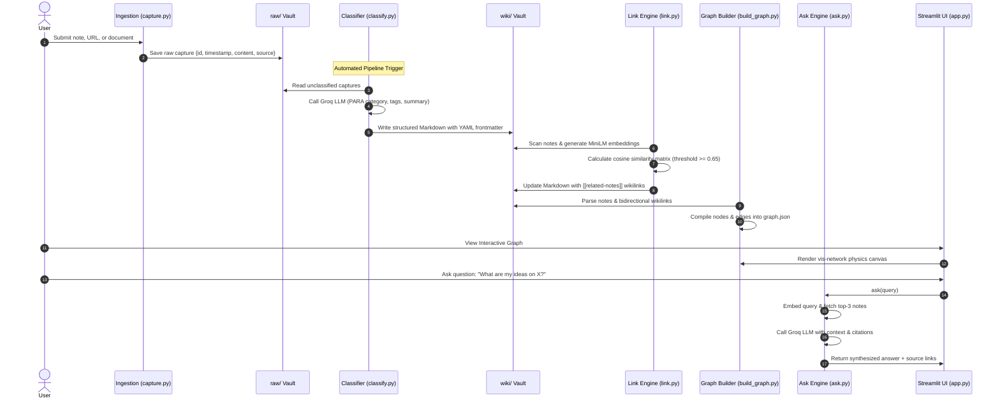

# SecondSelf: System Architecture Specification

# SecondSelf: System Architecture Specification
**Document Version:** 1.0.0  
**Target Platform:** Python 3.10+, Streamlit, Groq API / Llama 3, Sentence-Transformers, Vis-network  
**Author:** AI System Architect  

---

## 1. System Vision & Overview

**SecondSelf** is an autonomous, self-organizing personal knowledge engine. Rather than functioning as a passive note storage bucket or a generic disconnected chatbot, SecondSelf implements a continuous knowledge pipeline:
1. **Ingest** raw multi-modal information (notes, URLs, files) with zero friction.
2. **Classify** and structure knowledge automatically using the PARA methodology (*Projects, Areas, Resources, Archives*) via LLM reasoning.
3. **Connect** notes automatically via dense semantic vector embeddings and bidirectional links.
4. **Visualize** the holistic knowledge topography as a dynamic, interactive force-directed graph.
5. **Synthesize** answers to natural-language queries grounded strictly in personal accumulated notes (Retrieval-Augmented Generation).
6. **Deploy** as a single lightweight, publicly accessible web application.

---

## 2. High-Level Architecture

```mermaid
flowchart TD
    subgraph Ingestion["1. Ingestion Layer (Week 1: The Archivist)"]
        UI_In["Web Capture UI (app.py)"]
        CLI_In["CLI Capture (capture.py)"]
        URL_Scraper["URL Fetcher (trafilatura / readability)"]
        File_Parser["File Extractor (pypdf, markdown, txt)"]
        Raw_Store[("Raw Vault: raw/{id}.json")]
        
        CLI_In --> Raw_Store
        UI_In --> Raw_Store
        URL_Scraper -.-> CLI_In
        File_Parser -.-> CLI_In
    end

    subgraph Processing["2. Semantic Organization (Week 2: The Librarian)"]
        Classifier["Classifier Engine (classify.py)"]
        LLM["Fast LLM (Groq / Llama 3)"]
        Embedder["Embedding Engine (link.py - all-MiniLM-L6-v2)"]
        Linker["Auto-Linker (Cosine Similarity Engine)"]
        Wiki_Store[("Wiki Vault: wiki/{category}/{slug}.md")]
        
        Raw_Store --> Classifier
        Classifier <--> LLM
        Classifier --> Wiki_Store
        Wiki_Store --> Embedder
        Embedder --> Linker
        Linker -->|Inject [[wikilinks]]| Wiki_Store
    end

    subgraph KnowledgeGraph["3. Graph Engine (Week 3: The Cartographer)"]
        Graph_Builder["Graph Builder (build_graph.py)"]
        Graph_JSON[("Graph Cache: graph.json")]
        Vis_Engine["Interactive Graph Component (vis-network.js)"]
        
        Wiki_Store --> Graph_Builder
        Graph_Builder --> Graph_JSON
        Graph_JSON --> Vis_Engine
    end

    subgraph QueryRAG["4. Synthesis Engine (Week 4: The Oracle)"]
        Query_Input["User Query (Natural Language)"]
        Dense_Retrieval["Semantic Search (top-k cosine sim)"]
        Prompt_Builder["Grounded Context Assembler"]
        Answer_Gen["Synthesis LLM (Groq / Llama 3)"]
        
        Query_Input --> Dense_Retrieval
        Embedder -.-> Dense_Retrieval
        Dense_Retrieval -->|Top-k relevant notes| Prompt_Builder
        Wiki_Store -.-> Prompt_Builder
        Prompt_Builder --> Answer_Gen
    end

    subgraph Presentation["5. Unified Interface (Streamlit)"]
        App["Streamlit Dashboard (app.py)"]
        Vis_Engine --> App
        Answer_Gen --> App
    end
```

---

## 3. Data Flow & Lifecycle



---

## 4. Component Deep-Dive

### 4.1. Module 1: The Archivist (Capture Pipeline)
- **Role:** High-speed capture without cognitive friction.
- **Inputs:**
  - Raw strings / quick thoughts
  - Web URLs (scraped clean of ads/boilerplate using `trafilatura` or `beautifulsoup4`)
  - Files (`.txt`, `.md`, `.pdf` via `pypdf`)
- **Storage Contract:**
  Files stored in `raw/{id}.json`:
  ```json
  {
    "id": "20261116-162000-a1b2c3",
    "timestamp": "2026-11-16T16:20:00Z",
    "source_type": "url",
    "source_ref": "https://example.com/article",
    "title": "Article Title or First Line",
    "raw_content": "...full text...",
    "processed": false
  }
  ```

### 4.2. Module 2: The Librarian (Classification & Auto-Linking)
- **Role:** Turns unstructured captures into a clean, connected Markdown personal wiki.
- **Classification Engine (`classify.py`):**
  - Uses Groq API (`llama-3.3-70b-versatile` or `llama-3.1-8b-instant`) with strict JSON mode.
  - Categorizes into Tiago Forte's **PARA Framework**:
    - **Projects:** Active goals with finite deadlines.
    - **Areas:** Ongoing spheres of activity/responsibility.
    - **Resources:** Reference materials, topics of interest, bookmarks.
    - **Archives:** Inactive items saved for posterity.
  - Outputs structured YAML frontmatter + markdown body saved to `wiki/{category}/{slug}.md`.
- **Note Schema (`wiki/.../*.md`):**
  ```markdown
  ---
  id: "20261116-162000-a1b2c3"
  title: "Building Micro-SaaS with Python"
  para_category: "Projects"
  tags: ["saas", "python", "ideas"]
  summary: "Actionable roadmap for shipping small web services using FastAPI."
  created_at: "2026-11-16T16:20:00Z"
  source: "https://example.com/article"
  links: []
  ---

  # Building Micro-SaaS with Python
  
  [Summary / curated content here]

  ## Related Notes
*(No related notes found above similarity threshold)*